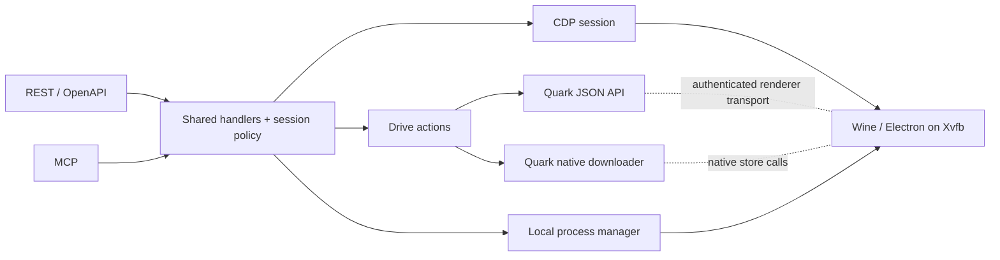

# quark-cloud-drive

Run Quark Cloud Drive unattended in a container and operate it through REST or
MCP. The container uses a virtual display (Xvfb) by default and needs no host
GPU or desktop. Wine/Electron still runs inside the container: it owns the
Quark login session and the native downloader. Only QR sign-in interacts with
the window.

## Architecture

The separation follows [NapCat's core/adapter design](https://github.com/NapNeko/NapCatQQ/blob/main/packages/napcat-adapter/index.ts):
one set of drive capabilities serves both external protocols.



- [Drive API](packages/drive/src/api) builds and parses Quark's API calls against
  a transport interface. The [renderer adapter](packages/drive/src/browser/renderer-http.ts)
  uses Quark's existing network stack and cookies. Native transfers call the
  download store directly. Neither path clicks through the UI.
- [Service](packages/service/src) owns sign-in, session attachment, the idle
  policy, and the REST and MCP adapters. Both adapters call the same handlers.
- [Manager](packages/manager/src) runs in the same Bun process. It serializes
  Wine lifecycle and window operations. The diagnostic CDP proxy supports
  DevTools; normal service requests attach to Quark's internal CDP port.

## Run

```bash
cp .env.example .env          # optional
docker compose up --build
```

- OpenAPI: `http://localhost:3000/` and `/spec.json`
- MCP (Streamable HTTP): `http://localhost:3000/mcp`
- Sign-in: `GET /login/qrcode` returns a PNG. Scan it with Quark, then check
  `GET /login/status`. `/vnc` is available if you need the full login window.
- Diagnostics: `/healthz`, `/status`, `/events`, `/history`, and `/devtools`.
  The default Compose file publishes one HTTP port. The development overlay
  also exposes CDP on the host's loopback interface.

The default Spark runtime uses `./wine-data-spark` for the Quark profile,
`./downloads` for files, and the `app-data` volume for runtime settings and
operation history. The launcher sets Quark's download directory to
`C:\users\wineuser\Downloads` and disables the floating window. To use GPU
acceleration, set `QUARK_DISPLAY=xorg` and mount `/dev/dri` via a Compose override.

Idle shutdown leaves the API running. The next drive request can start Quark;
an explicit `POST /manager/stop` keeps it stopped until `/manager/start` or
`/manager/restart`. Active local downloads and cloud tasks are considered when
deciding whether to idle. `GET/PATCH /config` controls the persisted idle policy.
`QUARK_AUTOSTART=false` disables startup at boot, while drive requests can still
wake the client.

## API v2

IDs from Quark are used throughout. The root folder is `fid=0`. HTTP requests
and MCP tools use the same field names; MCP takes flat arguments and returns
structured results.

| Operation | REST | MCP tool |
| --- | --- | --- |
| Sign-in status / QR | `GET /login/status` / `GET /login/qrcode` | `login_status` / `login_qr_code` |
| Account capacity | `GET /account` | `get_account` |
| List a folder / inspect a file | `GET /files?fid=0` / `GET /files/info?fid=…` | `list_files` / `get_file` |
| Queue a local download | `POST /downloads` with `{fid}` | `start_download` |
| Track a local download | `GET /downloads?taskId=…` | `list_downloads` |
| Pause, resume, or cancel local downloads | `PATCH /downloads` with `{taskIds,operation}` | `control_downloads` |
| List / control cloud tasks | `GET /cloud-tasks` / `PATCH /cloud-tasks` | `list_cloud_tasks` / `control_cloud_tasks` |
| Submit a share save | `POST /share-imports` with `{url,passcode?,toFid?}` | `save_share` |
| Check a share save | `GET /share-imports?taskId=…` | `get_share_import` |

A **local download** returns a task ID when Quark queues the transfer. Wait for
`status: "finish"` before using the file. Downloading a folder queues its entire
subtree. Files are written to the server's Downloads directory and appear under
the Compose bind mount.

A **share save** returns `status: "submitted"` and a task ID. Check the task
until it reports `completed` or a failure. While pending, pass
`nextRetryIndex` as `retryIndex` on the next check; do not resubmit the share to
check progress. `savedFids` contains only IDs reported by Quark. The destination
defaults to Quark's `来自：分享` folder; send `toFid: "0"` for root.

Migrating from v1:

- Replace `POST /download-file` and MCP `download_file` with `POST /downloads`
  and `start_download`. The URL-only GET and `download_urls` were removed.
  Downloads use the configured server mount; `toDir` is no longer an argument.
- Replace `/download-task` with `/downloads`, `/task-list` with
  `/cloud-tasks`, and `/import-share-link` with `/share-imports`.
- Replace `/list-file`, `/file-info`, `/user-info`, `/login-status`, and
  `/login-qrcode` with their v2 paths above. `/status` includes queue status.
- Process controls remain available over HTTP at `/manager/{status,start,stop,restart,minimize,restore,events}`.
  MCP only exposes sign-in and drive tools. The separate HTTP manager transport
  and the `QUARK_MANAGER_MODE` / `QUARK_MANAGER_URL` settings were removed.

## Development and checks

```bash
docker compose -f docker-compose.yaml -f compose.dev.yaml up --build
bun install --frozen-lockfile
bun run check
bun run test
```

The dev container watches the Bun service and reattaches to an already-running
Quark client after reload. Tests cover HTTP and MCP routing, share task
confirmation, and the native download interface with a simulated client.

With a running, signed-in Quark client, run `bun run test:e2e` to check file
queries and verify an actual download lands on disk. The download test queues a
small account file and removes the downloaded test artifact.
Set `QUARK_API_URL`, `QUARK_E2E_CDP_URL` (default
`http://127.0.0.1:9223`), and `QUARK_DOWNLOADS_HOST_DIR` when using a different
development port or mount. To test a real share save, also provide
`QUARK_E2E_SHARE_URL` and `QUARK_E2E_SHARE_TO_FID` for a test folder. This check
leaves the imported files in that folder for inspection.
